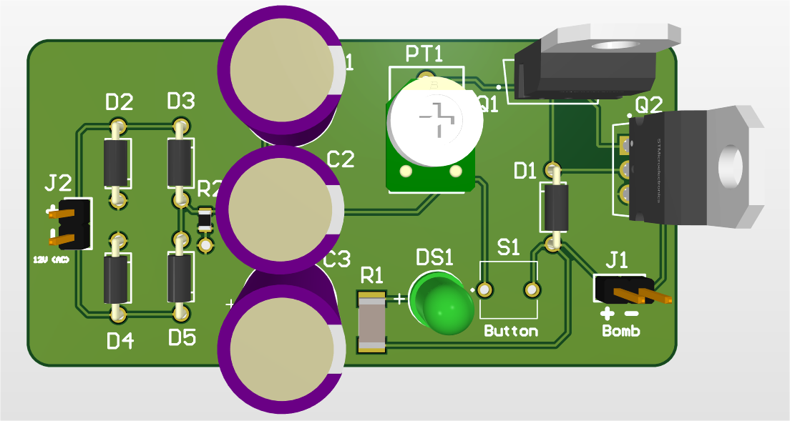
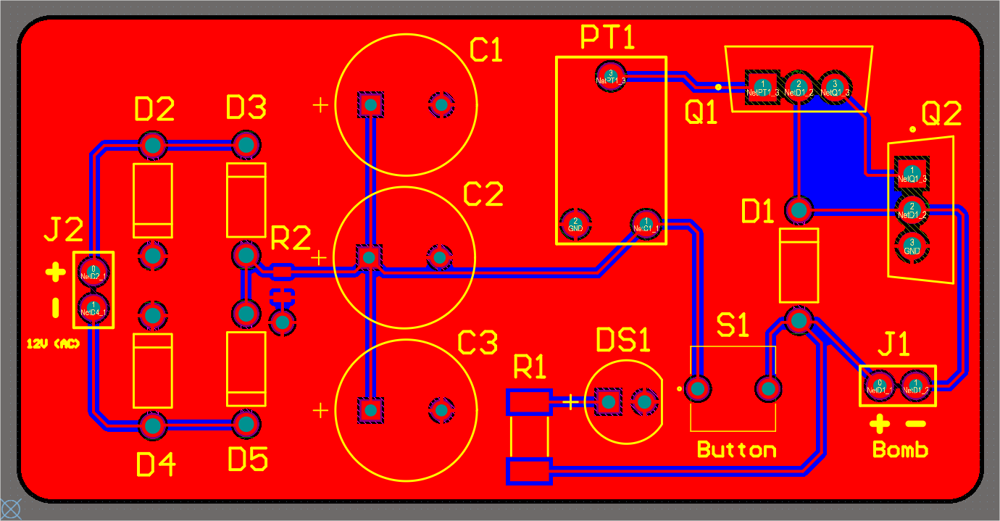
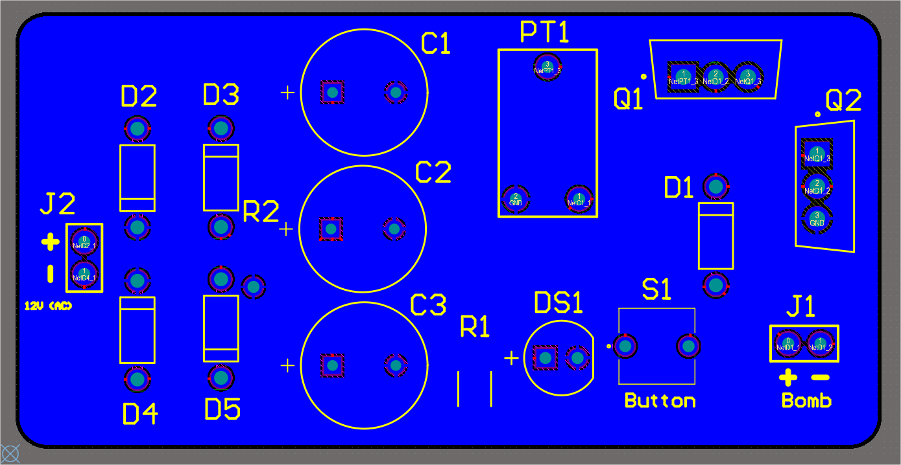
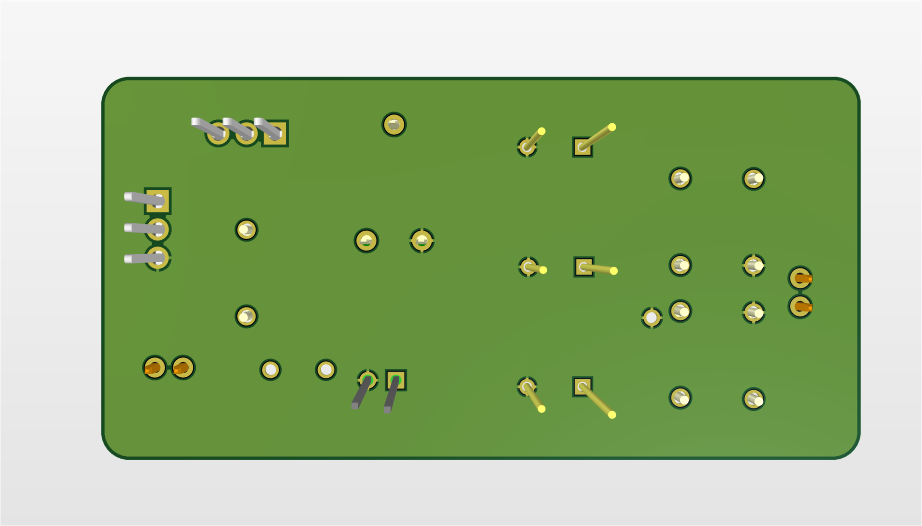
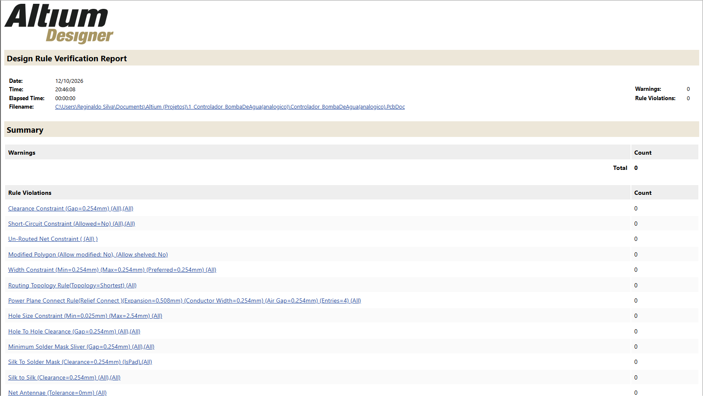

# Controlador Analógico de Bomba d'Água

Placa de circuito impresso (2 camadas) para acionar e controlar a velocidade de uma bomba d'água DC a partir de um transformador. Projeto feito no **Altium Designer 26.8.1**.



## Introdução

Este projeto é um retrabalho do trabalho da disciplina de Eletrônica I, que na época foi feito com pressa. Esta versão corrige e documenta o projeto.

## Como funciona

1. **Entrada (J2):** transformador 120 para 12 V AC.
2. **Retificação (D2–D5):** ponte retificadora com quatro diodos 1N4007.
3. **Filtro (C1–C3):** três capacitores eletrolíticos de 1 mF em paralelo (3 mF) alisam a tensão retificada.
4. **Controle (PT1, Q1, Q2):** o potenciômetro PT1 ajusta o sinal de base de dois transistores TIP31C em cascata, que controlam a corrente da bomba (J1) e, portanto, a sua velocidade.
5. **Acionamento (S1):** botão tátil que liga a bomba.
6. **Proteção (D1):** diodo 1N4007 em paralelo com a bomba (roda livre), protege os transistores contra picos de tensão da carga indutiva.
7. **Indicação (R1 + DS1):** LED verde com resistor de 270 Ω.
8. **R2 (10 kΩ):** resistor de 10 kΩ ligado ao GND na saída da ponte.


## Especificações

| Item | Valor |
|---|---|
| Entrada | 12 V AC (transformador) |
| Saída | Bomba DC de 2,5 a 6 V, ~200 mA na máxima eficiência (referência: Mini Bomba Sapo Aquário 5V, RoboBuilders RB0330) |
| Camadas | 2 |
| Dimensões | 68,4 x 34,5 mm |
| Software | Altium Designer 26.8.1 |

## Imagens

| Top (2D) | Bottom (2D) |
|---|---|
|  |  |

| Top (3D) | Bottom (3D) |
|---|---|
|  |  |

## Lista de componentes (BOM)

| Designador | Componente | Qtd. |
|---|---|---|
| C1, C2, C3 | Capacitor eletrolítico 1000 µF, 25 V | 3 |
| D1, D2, D3, D4, D5 | Diodo 1N4007 | 5 |
| DS1 | LED verde | 1 |
| J1 | Conector header 1x2, passo 2,54 mm (bomba) | 1 |
| J2 | Conector header 1x2, passo 2,54 mm (transformador) | 1 |
| PT1 | Potenciômetro (ou trimpot) 10 kΩ | 1 |
| Q1, Q2 | Transistor NPN TIP31C (TO-220) | 2 |
| R1 | Resistor 270 Ω, 1%, 2010 (SMD) | 1 |
| R2 | Resistor 10 kΩ (SMD) | 1 |
| S1 | Botão tátil | 1 |

A BOM completa está em [`fabrication/`](fabrication/).

## Estrutura do repositório

```
hardware/      Arquivos-fonte do Altium (projeto, esquemático, PCB e bibliotecas)
fabrication/   Gerbers, furação e BOM
docs/          Esquemático em PDF, imagens da placa e relatório do DRC
simulation/    Simulação em LTspice (em breve)
```

## Como abrir o projeto

1. Baixe ou clone este repositório.
2. Abra o arquivo `hardware/Controlador_BombaDeAgua(analogico).PrjPcb` no Altium Designer.
3. As bibliotecas (`.SchLib` e `.PcbLib`) estão na mesma pasta.

## Fabricação

Os arquivos Gerber e de furação estão compactados em `fabrication/`. Para encomendar, envie o `.zip` ao fabricante.

> Status: o DRC do Altium está sem erros



## Simulação

Em breve, em `simulation/` (LTspice).

## Autor

PedroS5 (Pedro Soares)

https://github.com/PedroS5
https://www.linkedin.com/in/pedro-soares-6402b7260/

## Licença

Este projeto está sob a licença MIT. Veja o arquivo [LICENSE](LICENSE) para mais detalhes.
